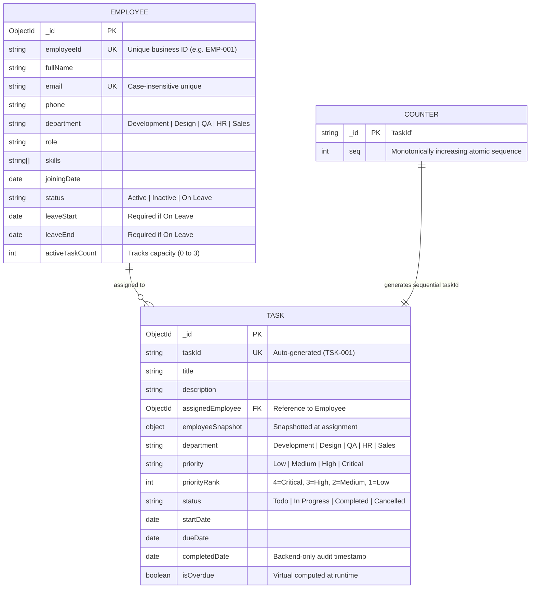

# MERN Employee & Task Management System

**Roots Media Marketing | MERN Stack Developer Intern | Technical Assignment**

A production-grade, full-stack enterprise employee and task management system built with **React 18 (Vite)**, **Node.js / Express**, **MongoDB / Mongoose**, and styled with **Tailwind CSS**.

---

## 📑 Table of Contents

1. [Architectural Overview & Folder Structure](#1-architectural-overview--folder-structure)
2. [Data Models & Schema Diagrams](#2-data-models--schema-diagrams)
3. [Business Rules & Concurrency Engine](#3-business-rules--concurrency-engine)
4. [Answers to Mandatory Technical Questions](#4-answers-to-mandatory-technical-questions)
5. [System Assumptions](#5-system-assumptions)
6. [API Documentation](#6-api-documentation)
7. [Environment Variables](#7-environment-variables)
8. [Local Installation & Running Instructions](#8-local-installation--running-instructions)
9. [Automated Test Suite & Verification Checklist](#9-automated-test-suite--verification-checklist)
10. [Deployment Guide (Render / Vercel)](#10-deployment-guide-render--vercel)

---

## 1. Architectural Overview & Folder Structure

The project strictly follows the clean layered architecture specified in the assignment plan:

```
mern_employee_task_management/
├── backend/
│   ├── src/
│   │   ├── config/          # db.js, env.js
│   │   ├── models/          # Employee.js, Task.js, Counter.js
│   │   ├── controllers/     # thin: req -> service -> res
│   │   ├── services/        # ALL business rules live here (employeeService, taskService, dashboardService)
│   │   ├── routes/          # employeeRoutes, taskRoutes, dashboardRoutes
│   │   ├── validators/      # Joi schemas with conditional validations
│   │   ├── middleware/      # errorHandler, validate, notFound
│   │   ├── utils/           # AppError, csv, dateHelpers, queryBuilder
│   │   ├── constants/       # statuses, transitions, departments, priorities
│   │   ├── app.js           # Express app setup and route mounting
│   │   └── server.js        # Server bootstrap and database connection
│   ├── scripts/             # seed.js, recomputeActiveCount.js
│   ├── tests/               # Automated test suite (api.test.js covering all rules)
│   ├── .env.example
│   └── package.json
├── frontend/
│   ├── src/
│   │   ├── api/             # axios instance + employeeApi, taskApi, dashboardApi
│   │   ├── components/
│   │   │   ├── common/      # Table, Pagination, StatusBadge, PriorityBadge, ConfirmDialog, PageLoader, FormField, EmptyState
│   │   │   └── layout/      # Navbar, Sidebar, Layout
│   │   ├── features/
│   │   │   ├── dashboard/   # Executive analytics and real-time workload
│   │   │   ├── employees/   # EmployeeListPage, EmployeeFormPage, EmployeeDetailPage
│   │   │   └── tasks/       # TaskListPage, TaskFormPage, TaskDetailPage
│   │   ├── hooks/           # useTaskFilters (URL state on useSearchParams), useDebounce
│   │   ├── utils/           # formatDate, constants
│   │   ├── index.css        # Tailwind directives and design system tokens
│   │   ├── App.jsx          # Route declarations
│   │   └── main.jsx         # React root bootstrap
│   ├── .env.example
│   ├── vite.config.js       # Vite configuration with /api proxy
│   ├── tailwind.config.js
│   └── package.json
└── README.md
```

---

## 2. Data Models & Schema Diagrams

### Mermaid Entity Relationship Diagram



### Key Model Distinctions

1. **Overdue is Never Stored in MongoDB**:
   - Storing `isOverdue` in the database produces stale data because a task can become overdue merely with the passage of time without any database write occurring.
   - It is computed dynamically via a single shared helper `isOverdue(task)` and the equivalent Mongo query fragment `getOverdueMongoQuery()`:
     ```js
     {
       dueDate: { $lt: todayMidnightUTC },
       status: { $in: ['Todo', 'In Progress'] }
     }
     ```
2. **Employee Snapshot on Task**:
   - Whenever a task is created or reassigned, `{ employeeId, fullName, email }` is copied into `task.employeeSnapshot`.
   - If an employee is deleted after completing their deliverables, historical reports, task detail views, and CSV exports still display the employee's name with a `(deleted)` tag.

---

## 3. Business Rules & Concurrency Engine

| Business Rule | Enforcement Mechanism |
|---|---|
| **Max Capacity <= 3** | Atomic `findOneAndUpdate` condition with active task counter check: `{ _id: id, status: { $in: ['Active', 'On Leave'] }, activeTaskCount: { $lt: 3 } }, { $inc: { activeTaskCount: 1 } }`. |
| **Assign only to Active / Available** | Rejects `Inactive` employees with `400`. For `On Leave` employees, rejects with `400` only if `leaveStart <= task.startDate <= leaveEnd` (inclusive). |
| **Due Date >= Start Date** | Enforced both in Joi validator schemas and in service layer before database persistence (`400 Bad Request`). |
| **Status Flow State Machine** | Strict `TRANSITIONS` matrix checked exclusively in `PUT /api/tasks/:id/status`. Terminal states (`Completed`, `Cancelled`) cannot transition to any other status. |
| **New Tasks Always Start as Todo** | `POST /api/tasks` strictly initializes status to `Todo`. Client-supplied status fields are rejected. |
| **Status Immutability via Normal PUT** | Normal update (`PUT /api/tasks/:id`) rejects any `status` field with `400`. Status can only be changed via `PUT /api/tasks/:id/status`. |
| **Terminal Tasks are Read-Only** | Any attempt to edit a task that is `Completed` or `Cancelled` is blocked with `400 Bad Request`. |
| **Backend-Only Completed Date** | `completedDate` is populated exclusively by the server timestamp when transitioning to `Completed`; rejected if passed by the client. |
| **Safe Employee Deletion** | Deletion is strictly blocked with `400` if the candidate currently has active tasks (`Todo` or `In Progress`) or assigned tasks in the system. Business rules forbid deleting candidates with assigned tasks. Candidates with 0 assigned tasks can be deleted, and historical tasks retain `employeeSnapshot` details. |
| **CSV Injection Protection** | Values starting with dangerous spreadsheet formulas (`=`, `+`, `-`, `@`, `\t`, `\r`) are escaped with a single quote prefix (`'`), and cells with quotes/commas are quoted. |

---

## 4. Answers to Mandatory Technical Questions

### 1. Status Validation
**Question:** Where should status transitions be validated, and why?
> **Answer:** Status transitions are validated **strictly on the backend service layer (`taskService.js`)** against a deterministic state machine transition matrix:
> ```js
> const TRANSITIONS = {
>   Todo: ['In Progress', 'Cancelled'],
>   'In Progress': ['Completed', 'Cancelled'],
>   Completed: [],
>   Cancelled: []
> };
> ```
> Validating purely on the frontend is insecure because any malicious or buggy client can bypass UI dropdowns with direct HTTP requests (e.g., via Postman or curl). The frontend only mirrors the backend by reading the server-computed `allowedNextStatuses` virtual array to populate available options.

### 2. Completed Date from Backend
**Question:** Why must `completedDate` be generated on the backend rather than passed from the client?
> **Answer:** 
> 1. **Client Clock Skew & Tampering:** The client system clock may be desynchronized, set in an arbitrary time zone, or intentionally modified by the user.
> 2. **Audit Integrity:** `completedDate` is a compliance audit timestamp. Enforcing `completedDate = new Date()` in `taskService.updateTaskStatus` when transitioning to `Completed` ensures an immutable, server-authoritative record. Client payloads passing `completedDate` are explicitly rejected.

### 3. Inactive / On-Leave Blocking
**Question:** How is assignment to Inactive or On-Leave employees prevented?
> **Answer:** In `taskService.js`, the helper `validateEmployeeForAssignment` checks the assigned employee's status and schedule:
> - If `status === 'Inactive'`, it immediately throws an `AppError(..., 400)`.
> - If `status === 'On Leave'`, it evaluates whether `task.startDate` falls within the employee's `[leaveStart, leaveEnd]` window (inclusive). If it overlaps, it throws an `AppError(..., 400)`.
> - If outside the leave window, assignment is permitted provided capacity is available.
> - This check is combined with an atomic `activeTaskCount: { $lt: 3 }` check to guarantee zero-defect assignment.

### 4. Backend Filtering & Pagination
**Question:** Why perform filtering, sorting, and pagination on the backend rather than the client?
> **Answer:**
> 1. **Scalability & Network Bandwidth:** Fetching thousands of records to the browser creates massive payload sizes, high latency, and browser memory bloat.
> 2. **Accurate Dataset Aggregations:** Server-side pagination computes exact `total` counts and `totalPages` directly via MongoDB indexes.
> 3. **Shared Business Logic with CSV Export:** The shared `buildTaskQuery(queryParams)` query builder is reused identically by `GET /api/tasks` and `GET /api/tasks/export/csv`, ensuring that the CSV export reflects the exact filtered dataset rather than just the currently viewed page.

### 5. Filters in the URL
**Question:** Why store filter state in the URL (`useSearchParams`) rather than component React state?
> **Answer:**
> 1. **Shareability:** A team member can copy the URL and share it with colleagues who will immediately see the exact same filtered and sorted view.
> 2. **Page Refresh Resilience:** Hard refreshing (F5) retains the user's active filters, search keywords, and page selection without reset.
> 3. **Browser History:** Users can use standard Browser Back/Forward buttons to navigate between previous filter configurations.

### 6. Concurrent 4th Task Prevention
**Question:** How does the system prevent the capacity race condition where two simultaneous requests assign a 4th task?
> **Answer:** Under a naive read-then-write approach (`countDocuments()`, followed by `Task.create()`), two concurrent requests can both read `activeTaskCount = 2`, both pass the check, and both create a task, resulting in 4 active tasks.
>
> We solve this using **MongoDB Atomic Conditional Updates**:
> ```javascript
> const updatedEmp = await Employee.findOneAndUpdate(
>   {
>     _id: assignedEmployee,
>     status: { $in: ['Active', 'On Leave'] },
>     activeTaskCount: { $lt: 3 }
>   },
>   { $inc: { activeTaskCount: 1 } },
>   { new: true }
> );
> if (!updatedEmp) {
>   throw new AppError('Employee has reached maximum capacity of 3 active tasks', 400);
> }
> ```
> Because MongoDB operations on a single document are atomic, the second concurrent update fails the `{ activeTaskCount: { $lt: 3 } }` query filter and returns `null`, successfully blocking the race condition. If task creation fails subsequent to the increment, a rollback `$inc: -1` is executed in a `catch` block.

---

## 5. System Assumptions

1. **Timezone:** Dates are normalized to midnight UTC (`00:00:00.000Z`) for date-only comparisons (e.g. `today`, `leaveStart`, `leaveEnd`, `dueDate`).
2. **Department Independence:** A task's department reflects the deliverable scope (e.g., a "Development" task can be assigned to a QA specialist or designer if cross-functional collaboration occurs).
3. **Status Changes while Holding Tasks:** If an employee's status is changed to `Inactive` or `On Leave` while they already hold active tasks, the existing tasks are preserved, but all subsequent new assignments are blocked until capacity and status permit.
4. **Hard Delete with Snapshot:** When an employee without assigned tasks is deleted, deletion succeeds. If an employee is ever deleted, their completed/cancelled historical tasks are preserved in MongoDB with `assignedEmployee: null` and the original `employeeSnapshot` retained. Candidates with assigned tasks are strictly blocked from deletion.

---

## 6. API Documentation

### Employees Endpoints

| Method | Endpoint | Description |
|---|---|---|
| `GET` | `/api/employees` | List employees (paginated, search, department/status filters, sort) |
| `GET` | `/api/employees/options` | Lightweight dropdown list of active employees with capacity counts |
| `GET` | `/api/employees/:id` | Get employee profile and their assigned active & historical tasks |
| `POST` | `/api/employees` | Create employee (enforces unique `employeeId` & `email` -> 409) |
| `PUT` | `/api/employees/:id` | Update employee details |
| `DELETE` | `/api/employees/:id` | Delete employee (blocked with 400 if active tasks > 0) |

### Tasks Endpoints

| Method | Endpoint | Description |
|---|---|---|
| `GET` | `/api/tasks` | List tasks with URL query filters, sorting, and pagination |
| `GET` | `/api/tasks/export/csv` | Stream CSV of all matching tasks (formula injection safe) |
| `GET` | `/api/tasks/:id` | Get single task details |
| `POST` | `/api/tasks` | Create task (atomic capacity <= 3, default Todo, auto `TSK-001`) |
| `PUT` | `/api/tasks/:id` | Update task details (rejects `status` and `completedDate` with 400) |
| `PUT` | `/api/tasks/:id/status` | Update task status via state machine (`Todo -> In Progress -> Completed/Cancelled`) |
| `DELETE` | `/api/tasks/:id` | Delete task (decrements employee active count if task was active) |

### Dashboard Endpoints

| Method | Endpoint | Description |
|---|---|---|
| `GET` | `/api/dashboard` | Aggregates employee statuses, task statuses, overdue count, and workload |
| `GET` | `/api/health` | Service health status check |

---

## 7. Environment Variables

### Backend (`backend/.env.example`)
```env
PORT=5000
NODE_ENV=development
MONGODB_URI=mongodb+srv://<username>:<password>@cluster0.mongodb.net/employee_task_management?retryWrites=true&w=majority
CLIENT_URL=http://localhost:5173
TIMEZONE=Asia/Kolkata
```

### Frontend (`frontend/.env.example`)
```env
VITE_API_URL=http://localhost:5000/api
```

---

## 8. Local Installation & Running Instructions

### Prerequisites
- **Node.js**: v18.0.0 or higher
- **npm**: v9.0.0 or higher

### 1. Clone & Setup Backend
```bash
cd backend
npm install
cp .env.example .env
```
*(Note: If no external MongoDB URI is provided, an embedded in-memory MongoDB will automatically start for instant zero-config evaluation).*

### 2. Populate Sample Seed Data
```bash
npm run seed
```

### 3. Run Backend Server
```bash
npm run dev
# Server will listen on http://localhost:5000
```

### 4. Setup & Run Frontend
```bash
cd ../frontend
npm install
cp .env.example .env
npm run dev
# Application will launch on http://localhost:5173
```

---

## 9. Automated Test Suite & Verification Checklist

The test suite in `backend/tests/api.test.js` covers every single requirement from Section 9 of the technical assignment:

```bash
cd backend
npm test
```

### Verified Checklist
- [x] **Assign to Inactive -> 400**
- [x] **On Leave boundary checks (inside leave window -> 400, outside -> 201)**
- [x] **Due date before Start date -> 400**
- [x] **Capacity <= 3 enforcement (4th active task blocked -> 400)**
- [x] **Concurrency race condition (2 parallel requests at an employee with 2 tasks -> only 1 succeeds)**
- [x] **Invalid state transitions (Todo -> Completed directly -> 400)**
- [x] **PUT /api/tasks/:id with status or completedDate in body -> 400**
- [x] **Edit a Completed or Cancelled task -> 400**
- [x] **Delete employee with active tasks -> 400**
- [x] **Delete employee without active tasks -> 200, old tasks preserve snapshot details**
- [x] **Duplicate email (case-insensitive) and duplicate employeeId -> 409 Conflict**
- [x] **Combined filters, sorting, and CSV export match filtered total**
- [x] **Dashboard overdue count equals task list overdue filter count**

---

## 10. Deployment Guide (Render / Vercel)

### Backend Deployment on Render
1. Create a new **Web Service** on [Render](https://render.com).
2. Connect your repository and set Root Directory to `backend`.
3. Build Command: `npm install`
4. Start Command: `npm start`
5. Add Environment Variables:
   - `NODE_ENV`: `production`
   - `MONGODB_URI`: `<Your MongoDB Atlas Replica Set Connection String>`
   - `CLIENT_URL`: `<Your Vercel Frontend URL>`

### Frontend Deployment on Vercel / Netlify
1. Create a new project on [Vercel](https://vercel.com).
2. Set Root Directory to `frontend`.
3. Framework Preset: `Vite`
4. Build Command: `npm run build`
5. Output Directory: `dist`
6. Add Environment Variable:
   - `VITE_API_URL`: `<Your Render Backend URL>/api`
7. Add Single Page App rewrite rule in `vercel.json` (or `_redirects` for Netlify) to support client-side routing:
   ```json
   {
     "rewrites": [{ "source": "/(.*)", "destination": "/index.html" }]
   }
   ```
